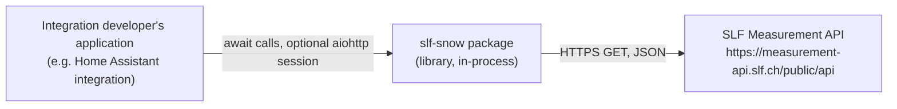
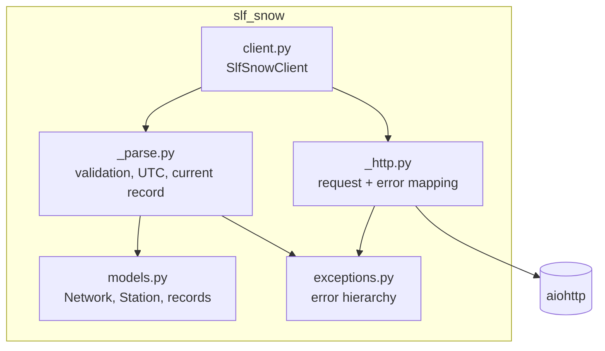
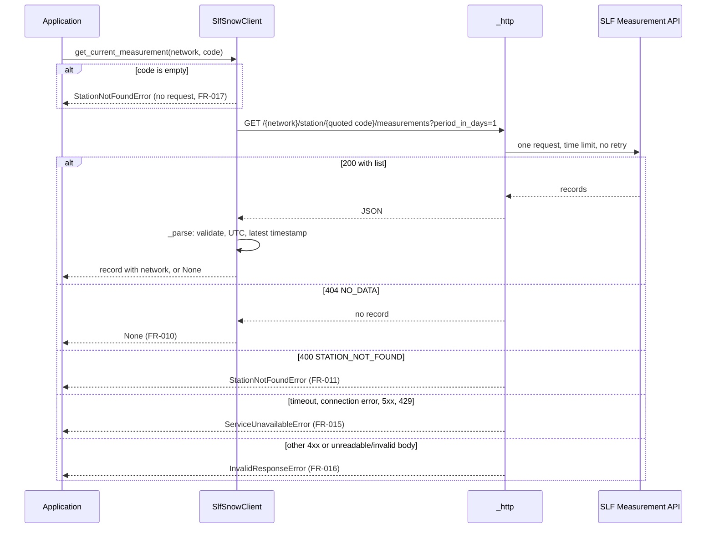
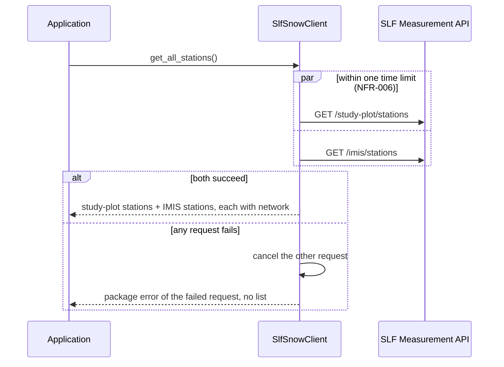

# Architecture: slf-snow-pypi

Status: Draft | Version: 0.1 | Date: 2026-11-02 | Spec version: 2.2

## 1. Context and scope
The package is an asynchronous Python library that an integration developer
embeds in an application (reference: a Home Assistant integration). It is the
only component that talks to the SLF Measurement API; it has no server, storage
or background activity of its own.

Used API resources (all `GET`, relative to `https://measurement-api.slf.ch/public/api`):

| Resource | Used for |
|----------|----------|
| `/study-plot/stations` | FR-001, FR-019 |
| `/imis/stations` | FR-002, FR-019 |
| `/study-plot/station/{code}/measurements?period_in_days=1` | FR-021 (network `study_plot`, [ADR-007](adr/ADR-007-query-period-for-station-measurements.md)) |
| `/imis/station/{code}/measurements?period_in_days=1` | FR-021 (network `imis`, [ADR-007](adr/ADR-007-query-period-for-station-measurements.md)) |
| `/study-plot/measurements` | FR-018 (study plots) |
| `/imis/measurements` | FR-018 (IMIS measured) |
| `/imis/daily-snow` | FR-005 (filtered by station code), FR-018 (modeled) |

## 2. Solution overview
- Python ≥ 3.14, matching Home Assistant Core ([ADR-001](adr/ADR-001-supported-python-versions.md)).
- aiohttp is the only runtime dependency; the consumer may pass an
  `aiohttp.ClientSession` ([ADR-002](adr/ADR-002-http-client-library.md)).
- Results are immutable standard-library dataclasses validated by own code
  ([ADR-003](adr/ADR-003-data-models-and-response-validation.md)).
- uv, hatchling, pytest with a local aiohttp test server, ruff and mypy strict
  ([ADR-004](adr/ADR-004-development-toolchain.md)).
- GitHub Actions with Trusted Publishing: tag → TestPyPI → owner approval → PyPI
  ([ADR-005](adr/ADR-005-ci-cd-and-release-process.md)).
- MIT license ([ADR-006](adr/ADR-006-license.md)).
- Single-station measurements are queried for a period of 1 day
  ([ADR-007](adr/ADR-007-query-period-for-station-measurements.md)).

Distribution name `slf-snow` (free on PyPI on 2026-11-02), import package
`slf_snow`.

## 3. Building blocks

| Component | Responsibility | Implements | ADRs |
|-----------|----------------|------------|------|
| `client.py` (`SlfSnowClient`) | Public async operations; owns or borrows the session; applies the time limit; runs the two requests of FR-019 concurrently, all or nothing; filters modeled values by station code; validates empty station codes before any request. | FR-001, FR-002, FR-005, FR-017 (empty code), FR-018, FR-019, FR-021; UC-001..UC-004 | ADR-002, ADR-007 |
| `_http.py` | Sends exactly one GET per invocation, without retries or redirects; encodes the station code as one path segment; maps transport failures and status codes to package errors or "no record". | FR-010 (`NO_DATA`), FR-011, FR-015, FR-016 (status), FR-017 | ADR-002 |
| `_parse.py` | Checks the basic form and the in-scope fields of each resource, ignores other fields, maps null to `None`, parses timestamps to timezone-aware UTC, selects the current record per station. | FR-008, FR-009, FR-010, FR-016, FR-018, FR-020 | ADR-003 |
| `models.py` | Immutable typed results: `Network` (`study_plot`, `imis`), `Station`, `StudyPlotRecord`, `ImisRecord`, `ModeledRecord`. | FR-007, FR-020, NFR-012 | ADR-003 |
| `exceptions.py` | `SlfSnowError` (base) with `StationNotFoundError`, `ServiceUnavailableError`, `InvalidResponseError`. | FR-011, FR-014, FR-015, FR-016 | ADR-003 |

Public interface (sketch; names may be refined during implementation without
changing behavior):

| Operation | Returns | Requirement |
|-----------|---------|-------------|
| `SlfSnowClient(session=None, *, timeout=10.0)`, `async with`, `close()` | client | NFR-006, NFR-009 |
| `get_study_plot_stations()` | `list[Station]` | FR-001, FR-020 |
| `get_imis_stations()` | `list[Station]` | FR-002, FR-020 |
| `get_all_stations()` | `list[Station]` | FR-019, FR-020 |
| `get_current_measurement(network, code)` | `StudyPlotRecord \| ImisRecord \| None` | FR-021, FR-020 |
| `get_current_study_plot_measurements()` | `list[StudyPlotRecord]` | FR-018 |
| `get_current_imis_measurements()` | `list[ImisRecord]` | FR-018 |
| `get_current_modeled(code)` | `ModeledRecord \| None` | FR-005, FR-007 |
| `get_current_modeled_all()` | `list[ModeledRecord]` | FR-018, FR-007 |

"No record" is `None`. `StudyPlotRecord` and `ImisRecord` carry `network`;
`ModeledRecord` is a separate type, so it cannot be mistaken for a measured
record (FR-007).

## 4. Runtime view

### Current measured record of a station (UC-002, FR-021)

### Combined station list (UC-001, FR-019)

Implementation: both requests run in an `asyncio.TaskGroup` inside one
`asyncio.timeout`; the first package error is re-raised from the resulting
exception group so that no `ExceptionGroup` reaches the consumer (FR-014).

## 5. Deployment
The package is not operated; it is published.
- **CI** (`.github/workflows/ci.yml`): lint, format check, typecheck and tests on
  Python 3.14 and 3.15 for every pull request and push.
- **Release** (`.github/workflows/release.yml`): tag `vX.Y.Z` → build sdist and
  wheel once → check tag equals project version → publish to TestPyPI
  (environment `testpypi`) → install check from TestPyPI → owner approval in
  environment `pypi` → publish to PyPI. Trusted Publishing, no stored secrets.
  Only the owner approves `pypi`.
- One-time setup by the owner: pending trusted publishers on PyPI and TestPyPI,
  GitHub environments `testpypi` and `pypi`, public issue tracker.

## 6. Crosscutting concepts
- **Error handling:** Classification in one place (`_http.py` for transport and
  status, `_parse.py` for content). Order: empty code → no request;
  `aiohttp.ClientError` or timeout → service unavailable; HTTP 429 or 5xx →
  service unavailable; HTTP 400 with `code` `STATION_NOT_FOUND` → station not
  found; HTTP 404 with `code` `NO_DATA` → no record; any other status other than
  200 → invalid response; body not JSON, not a list, or in-scope field missing
  or of the wrong type → invalid response. All errors derive from
  `SlfSnowError`; the original exception is kept as `__cause__`.
- **Request discipline:** Exactly one request per network covered by a call
  (NFR-004); no retries, no redirects followed (a redirect would be a second
  request); no request outside a call (NFR-005); no caching (NG-05).
- **Security:** Station codes are inserted with `urllib.parse.quote(code,
  safe="")` so that `/`, `..` and `?` cannot address another resource (FR-017).
  HTTPS only; no credentials, no personal data.
- **Configuration:** Only the time limit and the optional session are
  configurable. The base URL is fixed (tests point the client at a local server
  through an internal parameter).
- **Logging:** None in this version; errors carry the information.
- **Data attribution:** README states CC BY 4.0 and the required SLF attribution
  (NFR-007). Test fixtures derived from SLF responses carry a CC BY 4.0 note in
  `tests/fixtures/README.md`.

## 7. NFR mapping
| NFR | How it is met | Where | Verified by |
|-----|---------------|-------|-------------|
| NFR-001 | All data operations are `async`; aiohttp is non-blocking | `client.py` | mypy (coroutine signatures), tests |
| NFR-002 | Runtime dependency is aiohttp only | `pyproject.toml` | CI install in a clean environment |
| NFR-003 | One public operation per value set; no URLs or parsing for the consumer | `client.py` | tests per operation (UC ACs) |
| NFR-004 | One GET per network covered, no retries, no redirects | `_http.py`, `client.py` | request counter on the local test server |
| NFR-005 | No tasks, timers or requests outside calls | `client.py` | test: no request after construction |
| NFR-006 | `aiohttp.ClientTimeout(total=limit)` per request; `asyncio.timeout` around FR-019; default 10 s, constructor parameter | `client.py`, `_http.py` | test with a delaying test server and a short limit |
| NFR-007 | Attribution section in README | `README.md` | review before release |
| NFR-008 | Release workflow publishes to PyPI | `release.yml` | install check from TestPyPI, then PyPI |
| NFR-009 | Supplied session is used for all requests and never closed; own session created and closed by the client otherwise | `client.py` | test: supplied session still open after `close()` |
| NFR-010 | MIT license file and SPDX expression; aiohttp is Apache-2.0 AND MIT | `LICENSE`, `pyproject.toml` | review of metadata in the built wheel |
| NFR-011 | sdist built in public CI from a tag matching the version; issue tracker enabled | `release.yml`, GitHub settings | release workflow tag check |
| NFR-012 | Full annotations, `py.typed`, mypy strict | `src/slf_snow/` | `uv run mypy` in CI |

## 8. Risks and technical debt
- **Undocumented API behavior:** `NO_DATA` (HTTP 404), `STATION_NOT_FOUND`
  (HTTP 400), rolling query periods and record order are observed, not
  documented. A change shows up as *invalid response*; tests document the
  observed responses. Owner subscribes to the SLF data mailing list.
- **Load on SLF:** The terms state the interfaces are not dimensioned to serve
  customer systems directly. The package minimises requests (NFR-004, ADR-007),
  but polling frequency is the consumer's decision.
- **Redirects:** A 3xx answer is treated as *invalid response* (cannot be read
  as a list), since following it would be a second request.
- **Public types tied to aiohttp:** Switching the HTTP client is a breaking
  change (ADR-002).
- Revisit ADR-003 (dataclasses) if the data model grows significantly; revisit
  ADR-007 if consumers need older values.

## 9. Development & tooling
- Runtime and package manager: Python ≥ 3.14, uv; build backend hatchling
  (ADR-001, ADR-004)
- Install: `uv sync`
- Dev server: none (library)
- Build: `uv build`
- Test: `uv run pytest`
- Lint: `uv run ruff check` and `uv run ruff format --check`
- Typecheck: `uv run mypy`
- Source code: `src/slf_snow/`, tests: `tests/` (fixtures in `tests/fixtures/`)
- CI: `.github/workflows/ci.yml`, release: `.github/workflows/release.yml`

## 10. Changelog
| Version | Date | Change |
|---------|------|--------|
| 0.1 | 2026-11-02 | Initial draft |
